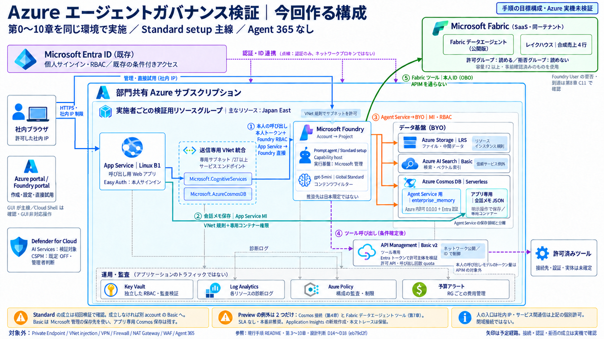
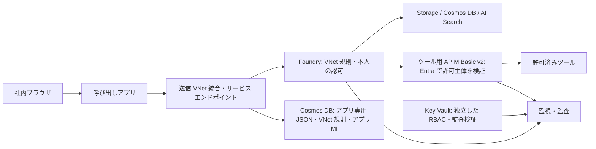

# Azure でガバナンス付きエージェント環境を作る

Microsoft Foundry の prompt agent を作り、権限・ネットワーク・監視・ゲートウェイ・Policy の統制を順に体験するハンズオンです。Azure 内で完結する構成 A（Agent 365 なし）を扱います。

> [!IMPORTANT]
> **第0章から第10章まで、下の順番で進みます。** 各ページ末尾の「次へ」をたどれば、通常手順で前の章へ戻る必要はありません。同じ環境に機能と統制を追加し、削除は最後に一度だけ行います。

> [!IMPORTANT]
> **現在は執筆途中のドラフトで、Azure は未実行です。** 実行順は整理済みですが、全操作が揃った完成手順ではありません。GUI／BYO 接続や呼び出しアプリなど、表の未完了部分を執筆・検証してから通し実行します。未確定箇所を飛ばして成功したとは扱いません。

本手順は学習用サンプルです。所属組織の公式見解や、本番構成の保証ではありません。

## 全体構成図

> **Note** 現行手順の設計判断 D14〜D17 を反映した目標構成です。Azure の実機検証は未実施です。本人の呼び出しは App Service の送信 VNet 統合・サービス エンドポイント経由で Foundry に直接接続し、APIM はツール経路に限定します。アプリ専用の Cosmos DB 保存は Agent Service の保存領域と分離します。

> **補足** 第0〜10章を一つの環境で順番に進めます。Standard setup の成立は初回検証で確認し、成立しなければ別 account の Basic setup に分岐します。Cosmos 接続のみ Preview の例外を採用し、Application Insights の新規作成・本文トレースは保留します。Key Vault は独立した RBAC・監査の検証対象です。

> **補足** Azure CLI／Bicep は原則 Cloud Shell 上の確認・任意の再現用（第7章の ZIP 配布とその認証・対象確認のみ社内 PC の CLI を使う暫定例外）です。Key Vault に実際のキーや接続文字列は保存しません。

## ハンズオン：ここから順番に進める

| 章 | 手順 | この章でできること | 執筆状況（すべて実機未検証） |
|---|---|---|---|
| 0 | [事前確認と検証の進め方](docs/00-before-start.md) | 対象・予算・IP・試験ユーザーを決める | 手順ドラフト |
| 1 | [準備と土台](docs/01-prerequisites.md) | RG・予算・Log Analytics ができる | 手順ドラフト |
| 2 | [Key Vault を準備する](docs/02-key-vault.md) | 監査用 Key Vault ができる | 手順ドラフト |
| 3 | [データ基盤を作る](docs/03-data.md) | Storage・Cosmos DB・Search ができる | サービス到達設定と作成時／直後のキー無効化を反映。Storage の B18 は初回照合・未実行 |
| 4 | [Foundry とエージェントを作る](docs/04-foundry-agent.md) | 同じデータ基盤を使うエージェントが応答する | G1〜G3 の根拠確認済み。GUI 作成→キー無効化→401→モデル配置。到達は C08 初回で確定、成立しなければ Basic |
| 5 | [人とサービスの権限を設定する](docs/05-identity.md) | 人とサービスの権限を分ける | 操作ドラフト・Consumer は Cloud Shell 代替・第4章完了後に実行 |
| 6 | [監視と監査を設定する](docs/06-monitoring.md) | 操作・本文の証跡を準備する | 操作ドラフト・本文のEntra取り込み／保護はPreviewのため保留 |
| 7 | [ゲートウェイと呼び出しアプリを用意する](docs/07-gateway-app.md) | 利用者がブラウザから呼べる入口を作る | 案 C＋アプリ実装済み（Easy Auth 転送・REST・Cosmos JSON 保存）。社内 PC の CLI 配布は暫定採用。本人トークン取得・配布・到達は初回実行で確認 |
| 8 | [権限・認証・ネットワークの統制を試す](docs/08-governance-tests.md) | 許可／拒否・IP・quota を比較する | 操作ドラフト・判定／証跡／復旧を具体化・実行は第7章の完成待ち |
| 9 | [Policy・脅威検知・評価を試す](docs/09-policy-defender-eval.md) | Audit → Deny、検知・評価を体験する | GUI操作・判定ドラフト済み。Policyの安全な拒否試験／モデル制限／AI実検知／自動評価の到達は保留 |
| 10 | [削除と費用を確認する](docs/10-cleanup-cost.md) | 最後に環境を削除し残存・費用を確認する | GUI操作・残存／費用判定ドラフト済み。削除・完全削除・課金の実機確認は未実施 |

**開始: [第0章・事前確認と検証の進め方](docs/00-before-start.md)**

途中章にある「確認」は、その時点で存在するものだけを対象にします。第5章では権限を設定し、第7章でアプリを用意した後、第8章で権限の効き方を試します。第5章へ戻って試験する必要はありません。

## 手順書の管理番号の読み方

以下は Azure の公式用語ではなく、この手順書内で項目を参照するための番号です。作業順は第0〜10章のままです。

| 表記 | 意味 | 定義場所 |
|---|---|---|
| G1〜G3 | 接続の提供範囲・サービス間通信・作成時認証の管理番号。2026-09-19 に根拠と方針を確定。到達は C08 | [第4章の確認根拠](docs/04-foundry-agent.md#作成前に確認した根拠) |
| C01〜C10 | 初回接続・権限・監査など、結果を判定する検証項目 | [検証項目の一覧](checks/README.md) |
| D1〜D16 | 構成を選んだ理由を記録した設計判断 | [設計判断の一覧](docs/90-design-decisions.md) |

各章では番号に短い説明を添えます。番号を覚えてから作業を始める必要はありません。

## 今回作る環境

第4章の G1〜G3 は根拠を確認済みです。主線は Standard setup のまま、Cosmos 接続の Preview 例外・3リソースのサービス到達設定・作成直後のキー無効化を適用します。IP 制限下で Agent Service が到達するかは C08 の初回実行で確定し、切り分けても成立しなければ新しい account の Basic setup に切り替えます。Cosmos だけを外した Standard setup は作りません。[開始・再開チェックリスト](docs/04-foundry-agent.md#作業開始再開前のチェックリスト) と、作成直後の401確認を含む各工程の条件を確認します。

上図は Standard setup の検証目標です。Basic 分岐後の Agent Service は Microsoft 管理の保存先を使用し、アプリ専用 Cosmos 保存は独立して残ります。アプリは実装済みで、Foundry のプロジェクト API への VNet 規則の適用と本人トークンの取得は第7章の初回実行で確認します。第7章の開始条件は維持します。Key Vault は独立した監査対象です。全章を通し実行できる検証済みの完成手順ではありません。

## 守る前提

- **作成・変更は Azure portal の GUI**。Cloud Shell（原則 Bash）は確認と GUI に無い操作の代替用です。Foundry account のキー無効化と直後の確認だけは PowerShell を使います（A13）。第7章のZIP配布だけは、LinuxのGUI非対応とSCMの社内IP制限のため、社内PCのAzure CLIを暫定採用します。理由と範囲は第7章に記載しています。
- 専用 RG を実施者ごとに分けます。既存の部門リソースを変更しません。
- 人の入口は社内 IP、認証は Entra ID。App Service → Foundry／アプリ専用 Cosmos は送信 VNet 統合＋サービス エンドポイントを使います。Agent Service 用には Search の信頼サービス例外・Storage のリソース インスタンス規則・Cosmos の `0.0.0.0` を採用します（D15）。
- ツール用 APIM はネットワーク上は公開し、Entra の許可主体で制限します。本人の呼び出しは APIM を通らず、モデルのトークン量・費用全体を APIM で制限したとは扱いません。
- 最初のエージェントはツールなし。ゲートウェイを用意した後、許可先だけ追加します。
- 既存の Entra 条件付きアクセスは変更しません。
- **Preview の唯一の例外は Azure Cosmos DB 接続（第4章・2026-09-19 承認）**です。SLA なし・本番非推奨を明示して NoSQL の体験を優先します。アプリ → Cosmos はこの例外に依存しない GA の経路です。
- App Service の送信 VNet 統合は対象です。Agent 365、Private Endpoint、VNet injection、VPN、Firewall、Bastion、NAT Gateway、WAF、上記例外以外の Preview 機能の操作は対象外です。
- Defender CSPM は既定 OFF。共有サブスクリプションへの変更は管理者判断です。
- API キー・トークン・実 ID・社内 IP・実名はリポジトリに保存しません。`.env`・`*.local.json`・`evidence/` は公開対象外です。

## 結果の記録

チームで使う [Issue記録ガイド・記載例](docs/ISSUE_RECORDING_GUIDE.md) と [非公開の証跡テンプレート](checks/evidence_template.md) を用意しています。定例中は全員が共有Excelへ記録します。手順修正や計画見直しが必要な課題をGitHub Issueへ転記し、以後はIssueを正本として皆でクローズまで管理します。ExcelにはIssueリンクと「GitHubで管理」を残します。準備は[第0章](docs/00-before-start.md)を参照します。

[確認項目 C01〜C10](checks/README.md) は番号を維持し、実施する章だけを整理しました。設定の存在・動作成功・拒否・未実施を区別します。記録は非公開の `evidence/` に残し、未実施は Pending とします。

一つの体験を終えるまで同じ RG を使います。日をまたぐ場合は予算と保管期間を確認します。途中で中止する場合は [第10章](docs/10-cleanup-cost.md) で片付けます。削除後に再現したいときだけ、第0章から新しい一周を始めます。

## 所要時間

旧計画の「Run 1／Run 2を別々に構築する」時間配分は、今回の一本道の所要時間として使いません。一周の所要時間は未計測です。アプリを追加した後の稼働時間と、日をまたぐ保管時間を含めて実績を記録します。

## 費用の目安

| 条件 | USD |
|---|---:|
| 既定・通常月 | $57.56 |
| 既定・3 か月 | $164.67 |
| 既定・12 か月 | $682.68 |
| CSPM ON（単独切替） | $108.66 / 月 |
| AI Search 常時（単独切替） | $150.39 / 月 |

2026-09-15 の見積り Excel v3 に基づきます。Japan East、原則 32h/月、CSPM 既定 OFF、累計には Defender AI の初月無料近似を含みます。見積り保証ではありません。明細 No.1〜19 は [第10章](docs/10-cleanup-cost.md) を参照します。

この金額は旧計画の稼働時間に基づく参考値で、今回の一周の費用を積算し直したものではありません。D14 は SKU を変更しません。App Service の VNet 統合と従来型サービス エンドポイントの機能追加料金はありませんが、サービス利用料・通信・ログ等まで無料になるわけではありません。Excel v3 の資産明細への VNet／サブネット追記は未実施です。

出典: [App Service VNet 統合](https://learn.microsoft.com/ja-jp/azure/app-service/overview-vnet-integration)、[サービス エンドポイント](https://learn.microsoft.com/ja-jp/azure/virtual-network/virtual-network-service-endpoints-overview)（取得日 2026-09-16）。

## 参考資料（通常手順では開く必要はありません）

- [設計判断](docs/90-design-decisions.md)
- [本番との差](docs/92-appendix-production-diff.md) — 差分・受入観点・再見積りのドラフト済み。本番設計・構築は対象外。
- [hosted agent の分岐 (任意)](docs/91-appendix-hosted-agent.md) — 採用条件・提供状態・試験設計のドラフト済み。実装・配布は前提確定待ち。
- [IaC で再現する (任意)](infra/README.md) — 現行スクリプトは旧 Run/セクション番号を維持し、固定停止点があります。
- [旧 Run 文書の扱い](docs/runs/run0.md)

本番向けの参考構成図・サービス全体像

この図の閉域・WAF 等は今回作る環境には含めません。

図中のすべての機能を今回検証するわけではありません。

## ライセンス

[MIT License](LICENSE)。公式テンプレートの著作権表示は [NOTICE](NOTICE.md) を参照してください。
