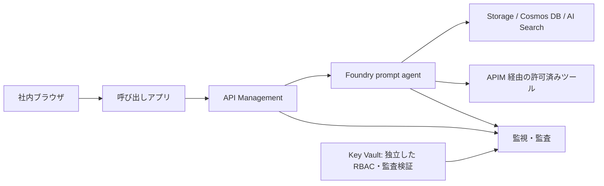
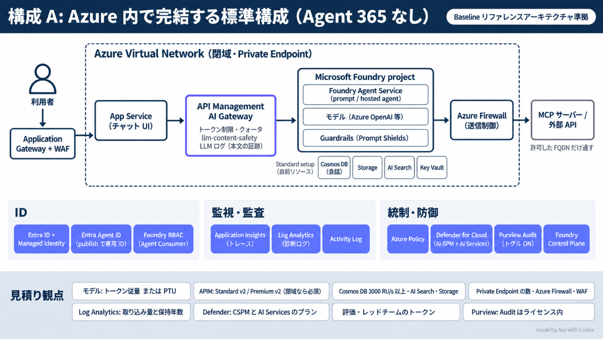
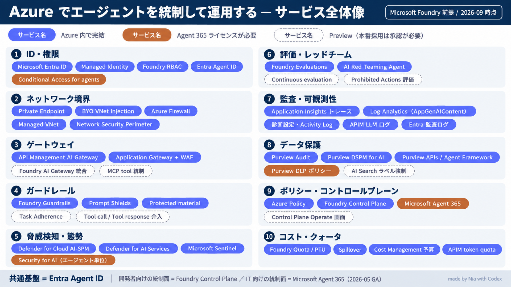

# Azure でガバナンス付きエージェント環境を作る

Microsoft Foundry の prompt agent を作り、権限・ネットワーク・監視・ゲートウェイ・Policy の統制を順に体験するハンズオンです。Azure 内で完結する構成 A（Agent 365 なし）を扱います。

> [!IMPORTANT]
> **第0章から第10章まで、下の順番で進みます。** 各ページ末尾の「次へ」をたどれば、通常手順で前の章へ戻る必要はありません。同じ環境に機能と統制を追加し、削除は最後に一度だけ行います。

> [!IMPORTANT]
> **現在は執筆途中のドラフトで、Azure は未実行です。** 実行順は整理済みですが、全操作が揃った完成手順ではありません。GUI／BYO 接続や呼び出しアプリなど、表の未完了部分を執筆・検証してから通し実行します。未確定箇所を飛ばして成功したとは扱いません。

本手順は学習用サンプルです。所属組織の公式見解や、本番構成の保証ではありません。

## ハンズオン：ここから順番に進める

| 章 | 手順 | この章でできること | 執筆状況（すべて実機未検証） |
|---|---|---|---|
| 0 | [事前確認と検証の進め方](docs/00-before-start.md) | 対象・予算・IP・試験ユーザーを決める | 手順ドラフト |
| 1 | [準備と土台](docs/01-prerequisites.md) | RG・予算・Log Analytics ができる | 手順ドラフト |
| 2 | [Key Vault を準備する](docs/02-key-vault.md) | 監査用 Key Vault ができる | 手順ドラフト |
| 3 | [データ基盤を作る](docs/03-data.md) | Storage・Cosmos DB・Search ができる | 構成ドラフト・GUI 詳細待ち |
| 4 | [Foundry とエージェントを作る](docs/04-foundry-agent.md) | 同じデータ基盤を使うエージェントが応答する | 構成ドラフト・GUI／BYO 接続待ち |
| 5 | [人とサービスの権限を設定する](docs/05-identity.md) | 人とサービスの権限を分ける | 手順ドラフト |
| 6 | [監視と監査を設定する](docs/06-monitoring.md) | 操作・本文の証跡を準備する | 構成ドラフト・本文トレース経路待ち |
| 7 | [ゲートウェイと呼び出しアプリを用意する](docs/07-gateway-app.md) | 利用者がブラウザから呼べる入口を作る | 構成ドラフト・アプリ未実装 |
| 8 | [権限・認証・ネットワークの統制を試す](docs/08-governance-tests.md) | 許可／拒否・IP・quota を比較する | 試験ドラフト・第7章の完成待ち |
| 9 | [Policy・脅威検知・評価を試す](docs/09-policy-defender-eval.md) | Audit → Deny、検知・評価を体験する | 構成ドラフト・設定詳細待ち |
| 10 | [削除と費用を確認する](docs/10-cleanup-cost.md) | 最後に環境を削除し残存・費用を確認する | 構成ドラフト・GUI 詳細待ち |

**開始: [第0章・事前確認と検証の進め方](docs/00-before-start.md)**

途中章にある「確認」は、その時点で存在するものだけを対象にします。第5章では権限を設定し、第7章でアプリを用意した後、第8章で権限の効き方を試します。第5章へ戻って試験する必要はありません。

## 今回作る環境

上図は検証の目標です。サービス間の IP 許可と本人トークンの経路は未確定で、第4・7章に停止条件を記載しています。Key Vault が Agent Service の必須接続先であることを示す図ではありません。

## 守る前提

- **作成・変更は Azure portal の GUI**。Cloud Shell（Bash）は確認と GUI に無い操作の代替用です。
- 専用 RG を実施者ごとに分けます。既存の部門リソースを変更しません。
- 入口は社内 IP、認証は Entra ID。サービス間の到達は別に確認します。
- 最初のエージェントはツールなし。ゲートウェイを用意した後、許可先だけ追加します。
- 既存の Entra 条件付きアクセスは変更しません。
- Agent 365、閉域接続、WAF、Preview 機能の操作は対象外です。
- Defender CSPM は既定 OFF。共有サブスクリプションへの変更は管理者判断です。
- API キー・トークン・実 ID・社内 IP・実名はリポジトリに保存しません。`.env`・`*.local.json`・`evidence/` は公開対象外です。

## 結果の記録

[確認項目 C01〜C10](checks/README.md) は番号を維持し、実施する章だけを整理しました。設定の存在・動作成功・拒否・未実施を区別します。記録は非公開の `evidence/` に残し、未実施は Pending とします。

一つの体験を終えるまで同じ RG を使います。日をまたぐ場合は予算と保管期間を確認します。途中で中止する場合は [第10章](docs/10-cleanup-cost.md) で片付けます。削除後に再現したいときだけ、第0章から新しい一周を始めます。

## 所要時間

旧計画の「Run 1／Run 2を別々に構築する」時間配分は、今回の一本道の所要時間として使いません。一周の所要時間は未計測です。アプリを追加した後の稼働時間と、日をまたぐ保管時間を含めて実績を記録します。

## 費用の目安

| 条件 | USD |
|---|---:|
| 既定・通常月 | $57.56 |
| 既定・3 か月 | $164.67 |
| 既定・12 か月 | $682.68 |
| CSPM ON（単独切替） | $108.66 / 月 |
| AI Search 常時（単独切替） | $150.39 / 月 |

2026-09-15 の見積り Excel v3 に基づきます。Japan East、原則 32h/月、CSPM 既定 OFF、累計には Defender AI の初月無料近似を含みます。見積り保証ではありません。明細 No.1〜19 は [S9](docs/10-cleanup-cost.md) を参照します。

この金額は旧計画の稼働時間に基づく参考値で、今回の一周の費用を積算し直したものではありません。

## 参考資料（通常手順では開く必要はありません）

- [設計判断](docs/90-design-decisions.md)
- [本番との差](docs/92-appendix-production-diff.md)
- [hosted agent の分岐 (任意)](docs/91-appendix-hosted-agent.md)
- [IaC で再現する (任意)](infra/README.md) — 現行スクリプトは旧 Run/セクション番号を維持し、固定停止点があります。
- [旧 Run 文書の扱い](docs/runs/run0.md)

本番向けの参考構成図・サービス全体像

この図の閉域・WAF 等は今回作る環境には含めません。

図中のすべての機能を今回検証するわけではありません。

## ライセンス

[MIT License](LICENSE)。公式テンプレートの著作権表示は [NOTICE](NOTICE.md) を参照してください。
