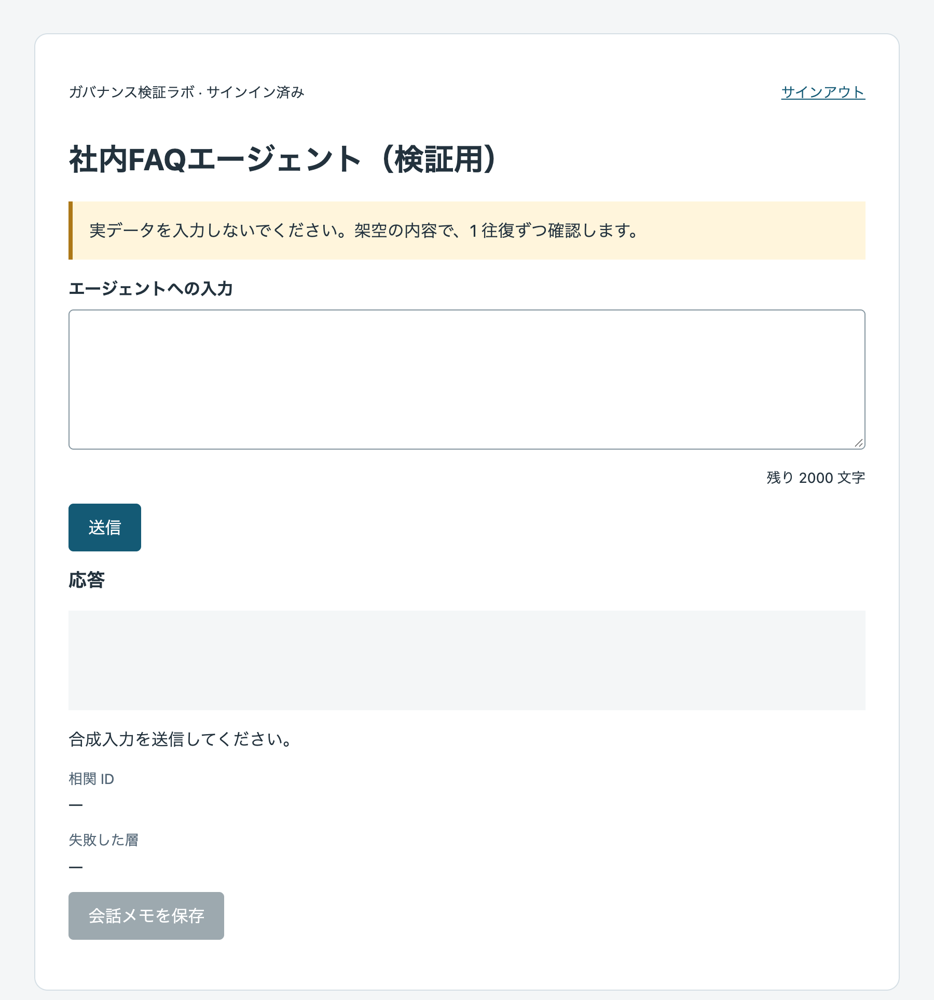
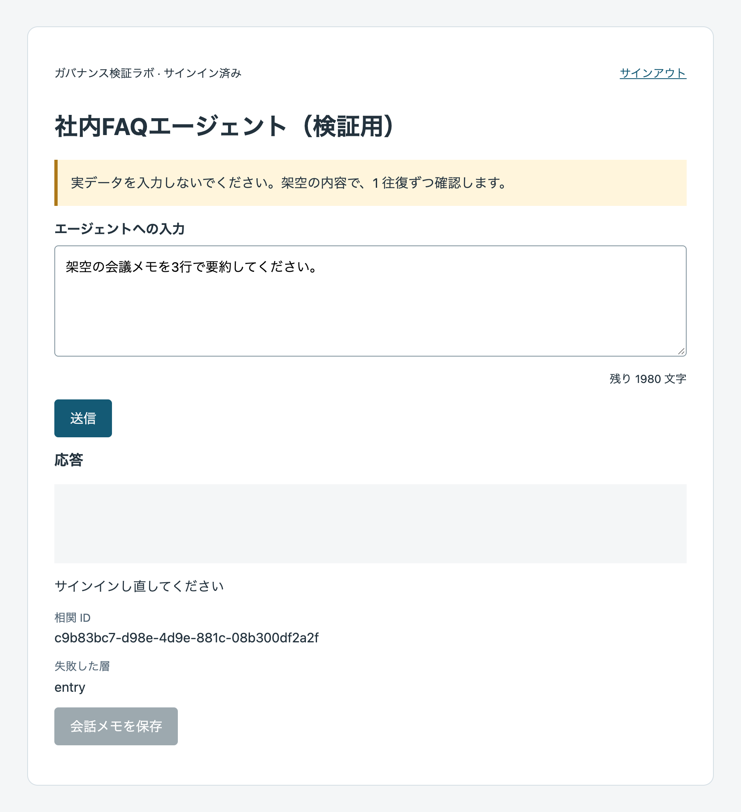
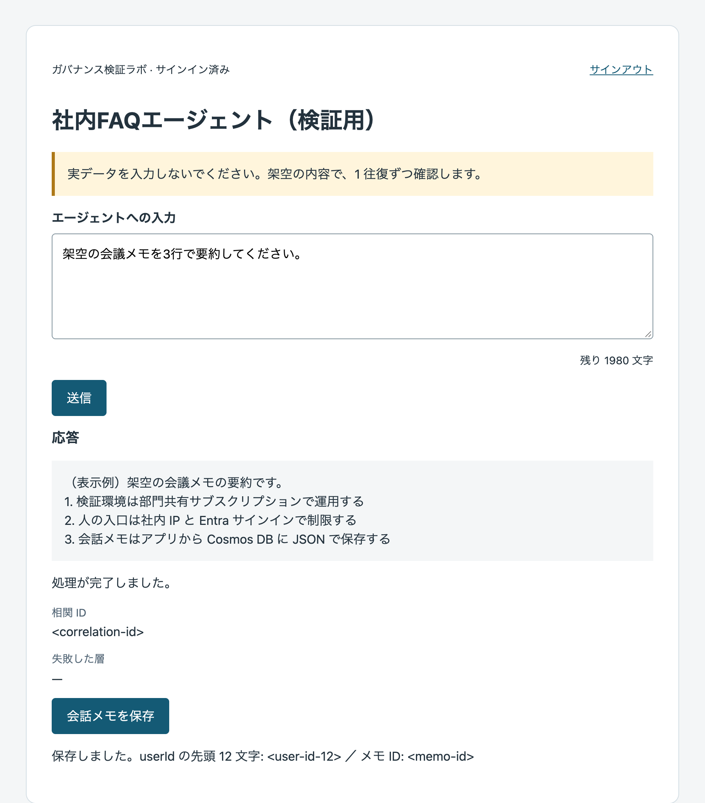

# 呼び出しアプリの仕様

> **Note** 状態: 確定版（実装済み・pytest 54 件をレビュー環境（Python 3.12・固定版どおりの依存）で実行し全件成功／Learn 2026-09 時点の記述に基づく・Azure 未実行）。更新日 2026-09-20

## 目的と範囲

第4章で作成した同じエージェントを、利用者本人の権限で呼ぶ Python／FastAPI アプリです。D14 の App Service Linux B1・送信 VNet 統合・Foundry VNet 規則を使います。追加シナリオ A14 では、合成会話をアプリ専用 Cosmos DB に JSON 保存します。本人経路は APIM を通りません。

### なぜこの作業が必要か

ブラウザの入力を本人のトークンで Foundry へ送り、入口・認証・認可・ネットワークの失敗を分けて確認するためです。Cosmos 保存は別機能で、エージェント実行の必須条件ではありません。エージェントの編集・任意 URL の入力・管理者への切替は提供しません。

## 1画面の操作

| 項目 | 実装 |
|---|---|
| サインイン | Easy Auth で同一テナントへサインイン。画面にはサインイン済みと表示 |
| 対象 | 設定で固定したエージェント表示名 |
| 入力 | 合成入力のみ。既定 2,000 文字、残り文字数を表示 |
| 送信 | [送信] で 1 往復。処理中は入力・送信・保存を無効化 |
| 応答 | `textContent` で表示し、HTML として解釈しない |
| 結果 | 相関 ID、失敗した層、次の操作を表示 |
| 履歴 | 直近 1 往復を画面内だけに保持。localStorage／sessionStorage／自動保存なし |
| 会話メモ | 応答が画面にあるときだけ [会話メモを保存] を有効化 |
| 終了 | [サインアウト] の移動前に入力・応答を消去し `/.auth/logout` へ移動 |

タイムアウト時に下流処理が停止したとは断定せず、自動再送しません。Easy Auth が HTML を返した場合は「サインインが切れています。ページを再読み込みしてください」と表示します。画面を消しても保存済みメモは削除されません。

### 画面の見え方（ローカル起動）

Azure 未接続でローカル起動した画面です。表示名と入力は架空です。

| 画像 | 状態 |
|---|---|
|  | 初期画面。残り文字数と [送信]、無効化された [会話メモを保存] |
|  | Easy Auth のヘッダーが無い状態で [送信] した実際の挙動。「失敗した層」が `entry`。相関 ID はローカルで生成した乱数 |
|  | 応答と保存結果の表示例。`/api/ask`・`/api/memo` の応答をブラウザ側でサンプル JSON に差し替えて描画したもので、Foundry・Cosmos は呼んでいない |

## 認証の契約

**採用: Easy Auth 転送（D-A1・D17、2026-09-20 承認）。** Easy Auth が入口のトークンの署名・発行者・audience（アプリ登録）を検証します。アプリは Easy Auth を通った要求だけを信頼し、`X-MS-CLIENT-PRINCIPAL-ID`、`X-MS-CLIENT-PRINCIPAL-IDP=aad`、`X-MS-TOKEN-AAD-ACCESS-TOKEN` を大文字小文字を区別せず読みます。Easy Auth を迂回してアプリへ直接到達できる構成では使いません。

`X-MS-TOKEN-AAD-EXPIRES-ON` は UTC の ISO 8601（末尾 Z・小数秒対応）として判定します。解釈不能・タイムゾーンなしの場合は拒否せず Foundry の検証へ進めます。期限切れは 401 `entry`／`expired` とし、ブラウザが `GET /.auth/refresh` 後に新しい相関 ID で 1 回だけ再送します。更新後も失敗すれば停止します。下流トークンの署名検証はアプリでは行わず、Foundry が検証します。

アクセストークンが無い場合の `no_token` は、トークン ストアが OFF、委任スコープ未設定、同意やプロバイダー資格情報の問題を確認します。トークン・oid・表示名はログに出しません。`ENTRA_TENANT_ID` は設定として必須ですが、アプリ内で JWT のテナント検証はしません。テナント制限は Easy Auth の設定で実施します。

OBO は不採用です。アプリ自身の API 公開・MSAL・シークレット管理が増えるためです。

> **Note** 要確認: `X-MS-CLIENT-PRINCIPAL-IDP` の値が `aad` であることは Learn の本文に明記がありません（ヘッダー名と「ID プロバイダー名が入る」ことだけが出典）。初回実行で全要求が `entry` 401 になる場合は、この値を [Log stream] ではなく設定と照合し、異なれば `app/auth.py` の判定値を直します。

POST は `Sec-Fetch-Site: same-origin`、`X-Requested-With: fetch`、`Content-Type: application/json` が必須です。`Sec-Fetch-Site` はブラウザが付与します。相関 ID はクライアントの UUID v4 を使い、欠落・不正形式ならサーバーが生成します。同じ ID は 30 秒間 409 で拒否します。**プロセス内メモリによる検知で、B1 の 1 インスタンス・uvicorn 1 プロセスが前提**です。再起動をまたぐ保証はありません。認証失敗も受信として記録するため、認証更新後の再送には新しい ID を使います。

## 呼び出す API の契約

| 項目 | 値 |
|---|---|
| アプリへの要求 | `POST /api/ask`、JSON `{"prompt": "<synthetic-prompt>"}` |
| Foundry への URL | `POST {FOUNDRY_PROJECT_ENDPOINT}/agents/{FOUNDRY_AGENT_NAME}/endpoint/protocols/openai/responses?api-version=v1` |
| ヘッダー | `Authorization: Bearer <Easy-Auth-access-token>`、`Content-Type: application/json`、`X-Correlation-Id` |
| 本文 | `{"input": [{"role": "user", "content": "<synthetic-prompt>"}]}` |
| 会話 | conversation を作らず、直近の要求だけを送信 |
| タイムアウト | 既定 60 秒、接続 10 秒。httpx の各 I/O 待機の上限で、処理全体の厳密な制限時間ではない |
| 抽出 | `output[]` の `type=message` → `content[]` の `type=output_text` の `text` を連結。無ければトップレベル `output_text`、両方無ければ空文字と `note=no_output_text` |
| 下流 ID | JSON の `id` が文字列なら `downstream_id`、無ければ null |

成功は `{"ok": true, "correlation_id": "<uuid-v4>", "duration_ms": 0, "text": "<text>", "downstream_id": "<downstream-id>", "app_version": "<version>"}`。失敗は `{"ok": false, "correlation_id": "<uuid-v4>", "layer": "<layer>", "reason": null, "status_upstream": null, "message": "<message>"}`。上流のエラー本文・ヘッダー・トークンは返しません。

> **Note** 要確認: 応答 JSON の形は初回に照合します。

> **Note** 要確認: Consumer での実行可否は C02 で確認します。

| 事象 | 応答 HTTP | layer / reason | 画面表示・検証項目 |
|---|---|---|---|
| 本人ヘッダー無し／IDP 不一致 | 401 | `entry` | サインインし直してください。入口の拒否だけで C03 合格にしない |
| アクセストークン無し | 401 | `entry` / `no_token` | 再サインインしても続く場合は管理者へ（トークン ストア／委任スコープ） |
| 期限切れ | 401 | `entry` / `expired` | 再認証が必要です。認証更新後 1 回だけ再送 |
| CSRF 不成立 | 403 | `csrf` | この操作は受け付けられません |
| 空／上限超過／不正な JSON | 400 | `input` | 入力を見直してください |
| 同じ相関 ID を 30 秒以内に再送 | 409 | `duplicate` | 送信済みです |
| Foundry 401 | 502 | `foundry_authn` | Foundry がトークンを拒否（C03） |
| Foundry 403 | 502 | `foundry_authz` | Foundry が権限を拒否（ロールなし・C02）。VNet 規則も別途照合 |
| Foundry 404 | 502 | `foundry_notfound` | エージェントまたはエンドポイントが見つからない（設定を確認） |
| Foundry 429／5xx／その他 4xx | 502 | `foundry_other` | Foundry からエラー（上流ステータスを表示） |
| Foundry 接続不可／タイムアウト | 504 | `network` | Foundry に到達できません（ネットワーク・C08） |
| Cosmos 401／403 | 502 | `cosmos_authz` | 保存先が拒否（MI のロール・A14）。VNet 規則も別途照合 |
| Cosmos 接続不可 | 504 | `cosmos_network` | 保存先に到達できません（VNet 規則・A14） |
| Cosmos その他 | 502 | `cosmos_other` | 保存先からエラー（A14） |

## 追加機能：会話メモを JSON で保存する（A14・D16）

Agent Service の状態保存とは独立したデータ操作です。Standard／Basic のどちらでも使い、第4章の Cosmos 接続の Preview は使いません。

| 項目 | 値 |
|---|---|
| 要求 | `POST /api/memo`、JSON `{"prompt": "<synthetic-prompt>", "response": "<synthetic-response>"}` |
| 認証・経路 | App Service のシステム割り当て MI・送信 VNet 統合・サービス エンドポイント・Cosmos VNet 規則 |
| データロール | Cosmos DB Built-in Data Contributor を `/dbs/<app-db>/colls/<app-container>` に限定 |
| 保存先 | アプリ専用 DB／コンテナー、パーティション キー `/userId`。`enterprise_memory` 禁止 |
| userId | `sha256(X-MS-CLIENT-PRINCIPAL-ID)` の 16 進 64 文字。ブラウザ指定値は無視。生の oid は保存しない |
| 文書 | `id`（UUID v4）、`userId`、`createdAt`（UTC ISO 8601）、`prompt`、`response`、`appVersion` |
| 上限 | prompt は `MAX_PROMPT_CHARS`、response は 20,000 文字。空文字・空白のみを拒否 |
| クライアント | `CosmosClient(url=COSMOS_ENDPOINT, credential=DefaultAzureCredential())` をプロセスで一度だけ遅延生成し再利用 |
| 成功応答 | `ok`、`correlation_id`、`memo_id`、`user_id_prefix`（先頭 12 文字）、`app_version` |

確認ポイント: [会話メモを保存] 後、検証担当者が [Data Explorer] で `memo_id` と JSON の `userId` の先頭 12 文字を画面と照合します。本文・識別子は診断ログや共有証跡へ貼りません。Cosmos が認可するのは MI で、Foundry の本人 RBAC の証拠にはなりません。削除は第10章で行います。

## 設定項目

実値は App Service に登録し、リポジトリや ZIP に保存しません。設定値の一覧をログへ出しません。

| 項目 | 値・既定値・検証規則 |
|---|---|
| `FOUNDRY_PROJECT_ENDPOINT` | 必須。HTTPS、ホスト末尾 `.services.ai.azure.com`、パス先頭 `/api/projects/` とプロジェクト名。ユーザー情報・query・fragment・443 以外のポートを拒否 |
| `FOUNDRY_AGENT_NAME` | 必須。`^[A-Za-z0-9_-]{1,64}$` |
| `FOUNDRY_AGENT_DISPLAY_NAME` | 任意。既定は agent name。HTML エスケープして表示 |
| `ENTRA_TENANT_ID` | 必須・空不可。Easy Auth 側の同一テナント設定と一致させる |
| `COSMOS_ENDPOINT` | 必須・HTTPS。ユーザー情報・query・fragment・443 以外のポートを拒否 |
| `COSMOS_DATABASE` | 必須・空不可。`<app-db>` |
| `COSMOS_CONTAINER` | 必須・空不可。`<app-container>`。`enterprise_memory` なら起動失敗 |
| `APP_VERSION` | 既定 `dev`。配布時は ZIP の版と一致させる |
| `MAX_PROMPT_CHARS` | 既定 2000。正の整数 |
| `FOUNDRY_TIMEOUT_SECONDS` | 既定 60。正の有限数 |

App Service 側で設定するもの:

| 項目 | 値 |
|---|---|
| `MICROSOFT_PROVIDER_AUTHENTICATION_SECRET` | Easy Auth 作成時に自動保存。値を見ない・記録しない。アプリは読み取らない |
| `WEBSITE_AUTH_AAD_ALLOWED_TENANTS` | `<tenant-id>`。Easy Auth で許可するテナント |
| `SCM_DO_BUILD_DURING_DEPLOYMENT` | `true`。配布時に Oryx が依存をビルド |

## ログと証跡

標準出力に 1 行 JSON で `ts`（UTC）、`correlation_id`、`route`、`status`、`layer`、`duration_ms`、`app_version` と、あれば `status_upstream` を出します。プロンプト・応答・トークン・ヘッダー一覧・oid・表示名・例外の生メッセージ・設定一覧は出しません。不正な相関 ID をログへ反射せず UUID v4 を生成します。

uvicorn のアクセスログは既定のままです。アプリはクエリへ秘密値を載せません。httpx や Azure SDK のデバッグ／HTTP 本文ログは有効にしません。Foundry 側の保存・監査・保持は第4・6章に従います。

`GET /healthz` は `{"ok": true, "app_version": "<version>"}` を返します。Easy Auth の除外パスは作らないため、**App Service の正常性チェック機能には使えません。サインイン後にブラウザで開く確認用**です。

## 配布物と配布方式

| ファイル | 内容・配布 |
|---|---|
| `app/__init__.py`、`app/main.py` | アプリ・4 ルート・静的ファイル配信。ZIP に収録 |
| `app/config.py`、`app/auth.py` | 設定検証・本人ヘッダー・期限・userId。ZIP に収録 |
| `app/foundry.py`、`app/cosmos.py` | REST と MI 保存。テスト時の差し替え可。ZIP に収録 |
| `app/static/index.html`、`app.js`、`app.css` | 外部 CDN・フォント・インライン JS なし。ZIP に収録 |
| `requirements.txt` | 下記の 5 行。ZIP ルートに収録 |
| `requirements-dev.txt` | `-r requirements.txt` と `pytest==9.1.1`。ZIP に含めない |
| `tests/__init__.py`、`conftest.py`、`test_auth.py`、`test_ask.py`、`test_memo.py`、`test_csrf.py` | 外部通信不要のテスト。ZIP に含めない |
| `README.md` | 本仕様。ZIP に含めない |
| [package_app.sh](../../scripts/package_app.sh) | リポジトリ側の配布スクリプト。ZIP に含めない |

```text
fastapi==0.141.1
uvicorn==0.53.0
httpx==0.28.1
azure-cosmos==4.17.1
azure-identity==1.25.3
```
実行結果の確認ポイント: `requirements.txt` の直接依存 5 つが固定されています。推移的依存は Oryx の pip 解決です。

Python 3.12 を対象とした構文です。固定依存の `requires_python` は FastAPI・uvicorn・pytest が `>=3.10`、httpx が `>=3.8`、azure-cosmos・azure-identity が `>=3.9` です。代替ランタイムの動作は未検証です。

[Configuration] → [General settings] → [Startup Command] の値:

```bash
python -m uvicorn app.main:app --host 0.0.0.0 --port 8000
```
実行結果の確認ポイント: [Log stream] で起動を確認します。

> **Note** 要確認: Python 3.12 の選択可否と uvicorn の待受ポート 8000 は初回に照合します。Service Unavailable の場合は [Log stream] を確認します。英語の画面名の日本語表示も初回に照合します。

社内 PC の Bash、リポジトリ直下で実行します。`<version>` は英数字で開始し、英数字・`.`・`_`・`-` だけで指定します。同じ版の上書きは拒否します。

```bash
bash scripts/package_app.sh '<version>'
```
実行結果の確認ポイント: `outputs/app-<version>.zip` と `.zip.sha256` が作られ、SHA256 が標準出力にも表示されます。ZIP のルート直下は `app/` と `requirements.txt` だけです。

macOS の照合:

```bash
(cd outputs && shasum -a 256 -c 'app-<version>.zip.sha256')
```
実行結果の確認ポイント: 対象 ZIP が OK と表示されます。

Linux の照合:

```bash
(cd outputs && sha256sum -c 'app-<version>.zip.sha256')
```
実行結果の確認ポイント: 対象 ZIP が OK と表示されます。

Linux の Kudu ZIP デプロイ UI は使えず、Cloud Shell は SCM の社内 IP 許可リストを満たしません。配布とその認証・対象確認だけ社内 PC の CLI を暫定採用します。Oryx が配布時にビルドするため社内 PC に Python は必須ではなく、venv は同梱しません。具体的な配布・GUI 確認は[第7章](../../docs/07-gateway-app.md#7-同梱アプリを配布する)に従います。

### ローカルで動かす (任意・開発者向け)

社内 PC 必須ではありません。以下は開発者が別環境で実施するための手順です。この Mac では pip install を行っていません。まず `assets/app` へ移動します。

```bash
cd assets/app
```
実行結果の確認ポイント: `requirements-dev.txt` があるディレクトリです。

```bash
python3 -m venv .venv
```
実行結果の確認ポイント: Python 3.12 の環境で `.venv` が作られます。

```bash
source .venv/bin/activate
```
実行結果の確認ポイント: 以降の Python と pip がこの仮想環境を使います。

```bash
pip install -r requirements-dev.txt
```
実行結果の確認ポイント: ランタイム依存 5 つと開発用 pytest が指定版で導入されます。

```bash
pytest
```
実行結果の確認ポイント: MockTransport／フェイクコンテナーだけでテストが通り、Azure や外部ネットワークへ接続しません。

次の起動はローカル画面の確認専用です。実在しないダミー値を指定し、Cosmos への保存は押しません。ダミーヘッダーは開発端末だけで使い、共有サーバーを起動しません。

```bash
FOUNDRY_PROJECT_ENDPOINT='https://test-resource.services.ai.azure.com/api/projects/test-project' FOUNDRY_AGENT_NAME='test-agent' ENTRA_TENANT_ID='test-tenant' COSMOS_ENDPOINT='https://cosmos.invalid' COSMOS_DATABASE='test-db' COSMOS_CONTAINER='test-container' python -m uvicorn app.main:app --host 127.0.0.1 --port 8000
```
実行結果の確認ポイント: ローカルだけで待受が開始します。起動だけでは Azure へ接続しません。

別の Bash で、Easy Auth ヘッダーのダミー値を付けて画面の GET を確認します。この GET は認証判定や Foundry の成功を検証するものではありません。API の拒否・成功は上記テストで確認します。

```bash
curl 'http://127.0.0.1:8000/' -H 'X-MS-CLIENT-PRINCIPAL-ID: test-principal-id' -H 'X-MS-CLIENT-PRINCIPAL-IDP: aad' -H 'X-MS-TOKEN-AAD-ACCESS-TOKEN: test-token-not-a-credential'
```
実行結果の確認ポイント: HTML が返り、ダミーエージェント名が含まれます。実際のトークンは貼り付けません。

## 受入条件

アプリは実装済みですが実機未検証です。レビュー環境（Python 3.12・`requirements-dev.txt` の固定版）で pytest 54 件が成功し、全 Python ファイルの `py_compile`、`bash -n`、ZIP の収録内容と SHA256 の照合も実施しました。テスト成功は MockTransport とフェイク コンテナーに対する動作であり、Azure での動作合格ではありません。

| 試験 | 期待結果 |
|---|---|
| 社内／社外から入口へ接続 | 社内の認証済みユーザーが使用でき、許可外IPは入口で拒否 |
| Consumer／User／無権限 | 第5・8章の本人ごとの権限に沿う。共有MIの権限で成功しない |
| 期限切れ・宛先不一致 | 再認証または拒否。トークンを画面・ログへ出さない |
| セッション分離 | 別ユーザーへ応答・トークン・会話を渡さない |
| 入力・出力 | 上限、二重送信、CSRF、HTML文字列の扱いを確認 |
| 到達性 | 統合先とVNet規則を照合し、対象エージェントから応答を得る |
| デプロイ | SCM制限下で同じ固定版を配置・起動できる |
| Cosmos 保存 | 明示操作した JSON がアプリ専用コンテナーの Data Explorer で見え、Agent Service のコンテナーに書かれない |
| Cosmos 認可・分離 | キー無しの MI 認証、コンテナースコープ、他人の `userId` を指定できないことを確認 |
| ログ | 合成入力で本文・トークンが診断ログに記録されないことを確認 |

### 出典

- 出典: [Foundry SDK クイックスタート](https://learn.microsoft.com/ja-jp/azure/foundry/quickstarts/get-started-code)（取得日 2026-09-16）
- 出典: [Foundry RBAC](https://learn.microsoft.com/ja-jp/azure/foundry/concepts/rbac-foundry)（取得日 2026-09-16）
- 出典: [Easy Auth のトークン](https://learn.microsoft.com/ja-jp/azure/app-service/configure-authentication-oauth-tokens)（取得日 2026-09-16）
- 出典: [OBO](https://learn.microsoft.com/ja-jp/entra/identity-platform/v2-oauth2-on-behalf-of-flow)（取得日 2026-09-16）
- 出典: [Python Web アプリ](https://learn.microsoft.com/ja-jp/azure/app-service/quickstart-python)（取得日 2026-09-16）
- 出典: [ZIP デプロイとLinux制約](https://learn.microsoft.com/ja-jp/azure/app-service/deploy-zip)（取得日 2026-09-16）

- 出典: [Cosmos DB の IP 規則とサービス エンドポイント](https://learn.microsoft.com/en-us/azure/cosmos-db/how-to-configure-firewall)（取得日 2026-09-19）
- 出典: [Cosmos DB の VNet 規則](https://learn.microsoft.com/en-us/azure/cosmos-db/how-to-configure-vnet-service-endpoint)（取得日 2026-09-19）
- 出典: [Cosmos DB のデータ面 RBAC](https://learn.microsoft.com/en-us/azure/cosmos-db/nosql/how-to-connect-role-based-access-control)（取得日 2026-09-19）

- 出典: [Linux Python と Oryx](https://learn.microsoft.com/en-us/azure/app-service/configure-language-python)（取得日 2026-09-19）
- 出典: [Easy Auth トークンと更新](https://learn.microsoft.com/en-us/azure/app-service/configure-authentication-oauth-tokens)（取得日 2026-09-19）
- 出典: [Easy Auth ユーザー識別](https://learn.microsoft.com/en-us/azure/app-service/configure-authentication-user-identities)（取得日 2026-09-19）
- 出典: [Entra プロバイダー設定](https://learn.microsoft.com/en-us/azure/app-service/configure-authentication-provider-aad)（取得日 2026-09-19）
- 出典: [既存エージェント REST](https://learn.microsoft.com/en-us/azure/foundry/quickstarts/get-started-code)（取得日 2026-09-19）
- 出典: [ZIP 配布](https://learn.microsoft.com/en-us/azure/app-service/deploy-zip)（取得日 2026-09-19）
- 出典: [Cosmos Entra 認証](https://learn.microsoft.com/en-us/azure/cosmos-db/nosql/how-to-connect-role-based-access-control)（取得日 2026-09-19）
- 出典: [authsettingsV2 REST（本文未取得・トークン資料から参照）](https://learn.microsoft.com/en-us/rest/api/appservice/web-apps/update-auth-settings-v-2)（取得日 2026-09-19）

---

[第7章に戻る](../../docs/07-gateway-app.md) / [トップ](../../README.md)
